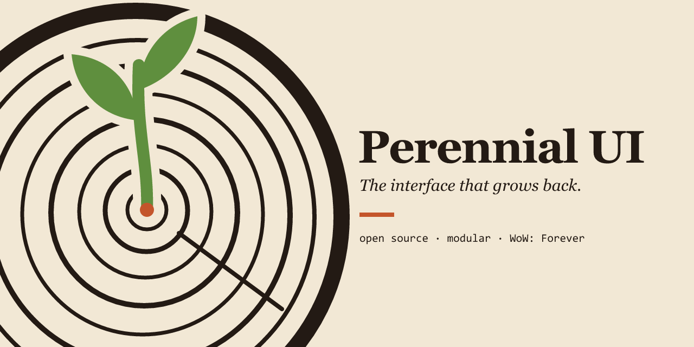

# Perennial UI



**An open-source, modular interface for World of Warcraft: Forever, built from scratch by the community.**

[](https://github.com/jshields-ca/PerennialUI/actions/workflows/ci.yml)
[](LICENSE)

> **Status: pre-alpha.** The core is in place and tested, but there is nothing to see in game yet. The first playable alpha ships when unit frames, action bars, bags and nameplates work. See the [roadmap](docs/ROADMAP.md).

## Why

The complete interface replacements for Forever that exist today are closed: all rights reserved, so nobody can fork them, fix them or build on them in the open. Perennial UI is the one you can.

- **Free software.** GPL-3.0-or-later. Fork it, change it, ship your changes.
- **Modular.** Every feature is a module with its own off switch. Turn one off and the game's default element comes back.
- **Resilient.** A module that keeps erroring is paused on its own. The rest of the UI keeps running and you are told what happened.
- **Its own thing.** Written from the game's behaviour and public feature lists, never from another addon's files. Its own code, its own look.

A perennial is a plant that grows back every year. That is the idea.

## What it will do

Full replacement of the default interface, built in phases:

| Phase | What you get |
| --- | --- |
| 0. Foundation | Core, settings window, profiles, layout mode, safety net |
| 1. Daily driver | Unit and raid frames, nameplates, cast bars, action bars, bags, minimap, chat, tooltips |
| 2. Combat | Cast warnings, damage meter, threat, swing timer, healer indicators, frame designer |
| 3. Questing | Quest automation, tracker, waypoints, leveling tools, vendor helpers |
| 4. Group, gear, economy | Group finder board, raid tools, upgrade scores, auction tools, alt overview, restyled windows |
| 5. Extras | Hunter and hardcore helpers, controller layout, Classic Era support |

The full list of 45 capabilities, and the test that closes each phase, is in the [roadmap](docs/ROADMAP.md).

## Install

There is no release yet. To try the current state, see [Develop](#develop) below. Once alphas start they will be on CurseForge, Wago and the [Releases](https://github.com/jshields-ca/PerennialUI/releases) page.

In game, `/pui` (or `/perennial`) lists the commands:

| Command | Does |
| --- | --- |
| `/pui` | Open the settings window |
| `/pui move` | Toggle layout mode to drag frames |
| `/pui undo` | Undo the last settings change |
| `/pui test` | Toggle test mode (sample data in frames) |
| `/pui safe` | Load with every module off, to rule Perennial in or out |
| `/pui modules` | List modules and their state |
| `/pui enable <id>` / `disable <id>` | Turn a module on or off |
| `/pui bug` | Print a report to paste into an issue |

## Develop

You need Git and a WoW: Forever install. Lua tooling is optional locally, because CI runs it for you on every pull request.

```bash
git clone https://github.com/jshields-ca/PerennialUI.git
```

Link the addon into your client so edits show up after `/reload`:

```powershell
.\tools\link.ps1 -AddOnsPath "C:\path\to\World of Warcraft\<forever folder>\Interface\AddOns"
```

```bash
tools/link.sh "/path/to/World of Warcraft/<forever folder>/Interface/AddOns"
```

To run the checks locally, install Lua 5.1 and LuaRocks, then:

```bash
luarocks install luacheck
```

```bash
luarocks install busted
```

```bash
luacheck . && busted && bash tools/check-files.sh
```

Where things are:

```text
PerennialUI/      the addon (Core, Compat, Settings, Modules, Media, Libs)
tests/            busted specs and a small WoW API stub
tools/            dev scripts
docs/             architecture, module contract, roadmap
```

Start with [docs/ARCHITECTURE.md](docs/ARCHITECTURE.md), then [docs/MODULES.md](docs/MODULES.md) to write a module.

## Contribute

Pull requests are welcome from anyone. A pull request merges by itself once the checks pass and a maintainer of the files it touches approves; regular contributors become maintainers of the modules they look after. [CONTRIBUTING.md](CONTRIBUTING.md) has the details, including the one rule that is not negotiable: **everything is written from scratch**.

## Licence

[GPL-3.0-or-later](LICENSE). Bundled third-party work keeps its own licence, listed in [THIRD_PARTY.md](THIRD_PARTY.md).

Perennial UI is an independent project. It is not affiliated with or endorsed by Blizzard Entertainment, or by the authors of any other addon. World of Warcraft is a trademark of Blizzard Entertainment, Inc.
